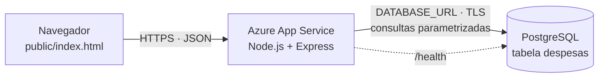

# Caixa da Associação de Moradores

Cloud Challenge · Desafio 07 · Prof. Roni Maciel · Senac 2026.2

## Problema e usuário

A associação presta contas todo mês em assembleia, mas as despesas ficam num caderno e os totais são somados na calculadora, então todo mês "não fecha" por alguns centavos. O usuário é o(a) tesoureiro(a), que precisa registrar despesas e emitir totais exatos por categoria e período.

## Equipe e papéis

| Integrante | Papel |
|---|---|
| Thauan Bezerra da Veiga Pessoa (Denji) | _(preencher)_ |
| _(preencher)_ | _(preencher)_ |
| _(preencher)_ | _(preencher)_ |

Nível de implantação: _(A, B ou C — preencher conforme o painel da turma)_

## Requisitos da ficha

| Req. | Descrição | Status |
|---|---|---|
| RF1 | Registrar despesa (descrição, valor > 0 com até 2 casas, categoria, data não futura) | Feito |
| RF2 | Listar por período (de/até) e categoria | Feito |
| RF3 | Totais por categoria e geral, calculados no banco, exatos ao centavo (regra central) | Feito |
| RF4 | Marcar como conferida; conferida não pode ser editada nem excluída | Feito |
| RF5 | Editar descrição, valor e categoria de despesa não conferida | Feito |
| `GET /health` | Testa a conexão com o banco | Feito |

## Arquitetura



Caminho de uma requisição: o navegador chama `POST /api/despesas`, o Express valida a entrada, o driver `pg` abre conexão com TLS usando a `DATABASE_URL` (variável de ambiente) e executa um `INSERT` parametrizado. O banco aplica as restrições e devolve a linha gravada.

**Decisão justificada: PostgreSQL (relacional) com `NUMERIC(10,2)`.**
Ganha-se exatidão aritmética (`SUM` no banco, sem erro de ponto flutuante, daí `0.1 + 0.2 ≠ 0.3` em `FLOAT`), restrições (`CHECK`) como última linha de defesa e consultas de agregação nativas (`GROUP BY`). Perde-se a simplicidade de um armazenamento chave-valor e há custo por hora do servidor (parar ao fim da aula). Somar na aplicação foi descartado: em JavaScript o driver devolve `NUMERIC` como texto e converter para `Number` reintroduz o erro de ponto flutuante.

**Outras decisões**
- Categorias fixas em `CHECK` (são 5 e raramente mudam; tabela própria seria excesso).
- "Hoje" = data de Brasília, calculada no servidor (o App Service roda em UTC).
- A API recebe ponto decimal (`12.50`); a interface aceita vírgula e converte.
- Exclusão física (`DELETE`) só para despesa não conferida; a conferida fica protegida como registro de prestação de contas.
- A regra "conferida não muda" é aplicada no próprio `UPDATE/DELETE ... WHERE conferida = false`, sem ler-e-depois-gravar, evitando corrida entre duas requisições.

## Modelo de dados

```sql
despesas(
  id           SERIAL PRIMARY KEY,
  descricao    VARCHAR(200)  NOT NULL CHECK (char_length(trim(descricao)) >= 3),
  valor        NUMERIC(10,2) NOT NULL CHECK (valor > 0),
  categoria    VARCHAR(20)   NOT NULL CHECK (categoria IN ('manutenção','limpeza','eventos','administrativo','outros')),
  data_despesa DATE          NOT NULL,
  conferida    BOOLEAN       NOT NULL DEFAULT false,
  criada_em    TIMESTAMPTZ   NOT NULL DEFAULT now()
)
```

Script completo em `banco/schema.sql` (inclui índice por data/categoria e o usuário de aplicação sem privilégio de administrador).

## API

| Método | Rota | Resposta |
|---|---|---|
| GET | `/health` | 200 ok, ou 503 se o banco não responde; traz `iniciado_em` |
| POST | `/api/despesas` | 201, ou 400 |
| GET | `/api/despesas?de=&ate=&categoria=` | 200 (limites inclusivos) |
| GET | `/api/relatorio?de=&ate=` | 200 com totais por categoria e geral |
| PUT | `/api/despesas/:id` | 200, 400, 404 ou 409 (conferida) |
| PATCH | `/api/despesas/:id/conferir` | 200, 404 ou 409 (já conferida) |
| DELETE | `/api/despesas/:id` | 204, 404 ou 409 (conferida) |

Requisições prontas em `requests.http`. Erros nunca expõem detalhes internos.

## Como executar

Pré-requisitos: Node.js 20+ e um PostgreSQL acessível.

```bash
git clone <url-do-repositorio> && cd gXX-caixa-moradores
npm install
cp .env.example .env        # preencha DATABASE_URL (o .env nunca vai para o Git)
psql "$DATABASE_URL" -f banco/schema.sql
npm start                   # http://localhost:3000
npm test                    # em outro terminal, com a aplicação rodando
```

Variáveis: `DATABASE_URL`, `DB_SSL` (opcional; TLS é automático se a URL contém `azure`), `PORT`.

### Plano de implantação na Azure

1. Grupo de recursos `rg-cloud-gXX` (tags `aula = cloud-challenge`, `grupo = gXX`).
2. App Service Linux, plano Gratuito F1, runtime `NODE:20-lts`, nome `app-cloud-gXX-iniciais`.
3. Azure Database for PostgreSQL Servidor Flexível (v16, B1ms, acesso público, permitir serviços do Azure e o IP atual), ou o banco compartilhado do professor (Nível B).
4. Rodar `banco/schema.sql` no banco (Cloud Shell com `psql` ou Editor de consultas).
5. App Service > Variáveis de ambiente: adicionar `DATABASE_URL`.
6. Publicar: `az webapp up --name app-cloud-gXX-ab --resource-group rg-cloud-gXX --plan plan-cloud-gXX --sku F1 --runtime "NODE:20-lts" --location brazilsouth`.
7. Conferir `GET /health` e, ao fim da aula, **parar o servidor PostgreSQL**.

## Casos de teste

Executados com `npm test` (resultado em `evidencias/resultado-testes-local.txt`). Refazer na URL pública para a evidência E3 do Nível A (`BASE_URL=https://... npm test`).

| Caso | Esperado | Obtido | Resultado |
|---|---|---|---|
| CA1 valor 0, −5 e 12.345 | 400 | 400 | PASSOU |
| CA2 data futura | 400 | 400 | PASSOU |
| CA3 10,10 + 20,20 + 0,70 | total 31.00 | 31.00 | PASSOU |
| CA4 período filtrado, limites inclusivos | ignora dias fora | 31.00 no dia; 331.00 em 3 dias | PASSOU |
| CA5 editar/excluir conferida | 409 | 409 | PASSOU |
| Extra: id inexistente | 404 | 404 | PASSOU |
| Extra: SQL injection no filtro | 400 sem detalhe interno | 400 | PASSOU |

Resultados acima obtidos com PostgreSQL local. Banco indisponível devolve 503 em `/health` (verificado derrubando o banco).

## Evidências

Pasta `evidencias/` (prints com data e hora visíveis):

- [ ] E1 URL pública (Nível A) ou descrição do ambiente (B e C)
- [ ] E2 quatro prints da prova de persistência (`GXX-PALAVRA`)
- [ ] E3 casos de teste (tabela acima + saída do `npm test`)
- [ ] E4 diagrama de arquitetura (acima)
- [ ] E5 print das variáveis de ambiente com valor oculto + `.gitignore` com `.env`
- [ ] E6 link do vídeo do pitch: _(colar aqui)_
- [ ] Específicas: print do CA3 (31,00) e do relatório por categoria

## Dificuldade superada

_(Preencher com a dificuldade real do grupo: problema, diagnóstico, causa e solução.)_

## Limitações conhecidas e próximos passos

- Sem login: qualquer pessoa com a URL registra e confere despesas. Próximo passo: autenticação e perfil de tesoureiro.
- Conferida é irreversível por desenho; um estorno auditado exigiria nova tabela.
- Extras possíveis: orçamento mensal por categoria com alerta, exportação CSV, comprovante no Blob Storage.
